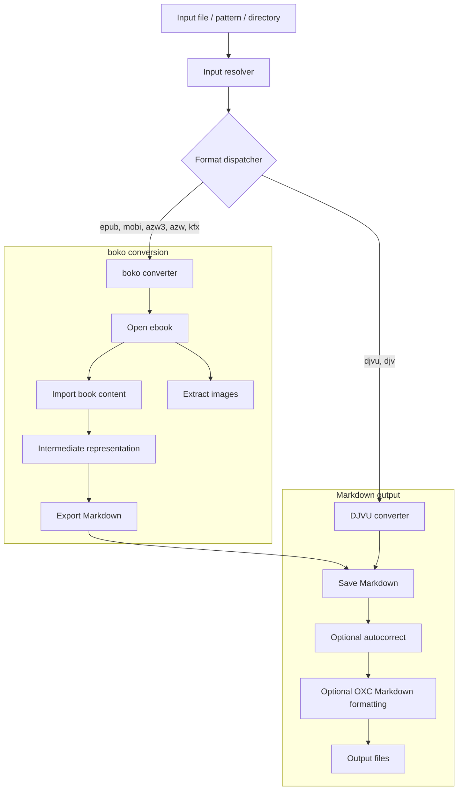

# tawata (多和田)

> Convert various ebook formats to Markdown at the command line

[](https://circleci.com/gh/paazmaya/tawata)
[](https://codecov.io/gh/paazmaya/tawata)



## Installation

Build from source using Rust and Cargo (requires Rust 1.97+):

```sh
cargo build --release
```

The compiled binary will be located at `target/release/tawata`.

## Usage

```sh
tawata [OPTIONS] <INPUT>
```

`<INPUT>` is a supported ebook file, a `*` glob pattern (quote it to prevent the
shell from expanding it), or a directory. Supported file extensions are
`epub`, `mobi`, `azw3`, `azw`, and `kfx` (converted with `boko`), and `djvu`
and `djv` (converted with `djvu-rs`). Directory scans include supported files
at the top level; use `--recursive` to include subdirectories. Glob patterns
are expanded by `tawata`; unsupported matches are skipped.

| Option                | Description                                                                                                                                                                                                  |
| :-------------------- | :----------------------------------------------------------------------------------------------------------------------------------------------------------------------------------------------------------- |
| `-r`, `--recursive`   | Include nested directories when `<INPUT>` is a directory. Has no effect on a file or glob pattern.                                                                                                           |
| `-a`, `--autocorrect` | Fix spacing between CJK and Western text, rejoin words split by spaces (3+ single letters), and collapse repeated spaces while preserving Markdown code blocks, indentation, and two-space hard line breaks. |
| `--no-oxfmt`          | Do not format generated Markdown with the OXC Markdown formatter. Formatting is enabled by default.                                                                                                          |
| `--single-file`       | For EPUB, MOBI, AZW3, AZW, and KFX, write `book.md` instead of one file per chapter. DJVU always produces one file per page, so this option does not affect it.                                              |
| `-h`, `--help`        | Show command-line help.                                                                                                                                                                                      |
| `-V`, `--version`     | Show the installed version.                                                                                                                                                                                  |

For an input such as `books/novel.epub`, output is written next to the input in
`books/novel/`. By default, the Markdown files are named `chapter_001.md`,
`chapter_002.md`, and so on, and any extracted images are saved in `images/`
(created only when the ebook contains images, with collision-safe filenames).
`--single-file` writes `book.md` in that same output directory. If chapter
boundaries cannot be reliably identified, the converter falls back to
`book.md`. A DJVU input instead produces `page_001.md`, `page_002.md`, and so
on; a page without a text layer gets a placeholder message.

The input is opened read-only and is never modified. The complete input is read
into memory before conversion; output is written to a separate directory, and
the input file itself cannot be used as the output directory. If any supported
ebook file fails to convert, `tawata` stops and exits with a non-zero status code.

### Examples

Each command is followed by a brief description of the resulting output. The
examples use `book.epub` as the input; its output directory is `book/`.

```sh
# Default: book/chapter_001.md, book/chapter_002.md, ... and book/images/
tawata book.epub

# Same chapter files and images, but skip Markdown formatting
tawata --no-oxfmt book.epub

# One Markdown file, book/book.md, plus book/images/
tawata --single-file book.epub

# Chapter files with spacing corrections and split-word cleanup
tawata -a book.epub

# Recursively find supported ebooks under ./library; each gets its own
# output directory beside its source file
tawata -r ./library

# One book.md per supported ebook found, retaining the same per-book directories
tawata -r --single-file ./library
```

Other input examples:

```sh
# Convert every matching KFX file; each output goes beside its source file
tawata "books/*.kfx"

# Scan only the top level of ./library and create output for each supported ebook
tawata ./library

# DJVU always produces one Markdown file per page in scan/
tawata -a scan.djvu
```

To see detailed CLI usage and option descriptions, run `tawata --help`.
For debug logging, set `RUST_LOG=debug` before running the command (for example,
`RUST_LOG=debug tawata book.epub` in a POSIX shell or
`$env:RUST_LOG = "debug"; tawata book.epub` in PowerShell).

## The "Autocorrect" Feature Explained

Autocorrect is intended to improve spacing and punctuation between CJK
(Chinese/Japanese/Korean) characters and English words using Markdown-aware
formatting. Ebook conversion can also insert spaces between individual letters
when the source uses separate styled spans. With `--autocorrect`, Tawata
rejoins sequences of three or more single-letter tokens (such as `w o r d`) and
collapses repeated inline spaces while preserving fenced code blocks, inline
code spans, leading line indentation, and trailing two-space hard line breaks.

## Background for the project name

The name of the project is for honouring the legacy of a late master, Mr Tawata
from the Ryukyu archipelago, who contributed to the martial arts that we today
know as **karate** and **ryukyu kobujutsu**.

There are forms carrying his name, such as "Tawata no Passai" and
["Tawata no Sai"](https://www.youtube.com/watch?v=YAQlFJIj32E), which both have
distinctive use of a stance called "nekoashidachi" and sweeping motion related
to the given stance.

[Read more about why these martial arts are important for me at `karatejukka.fi`.](https://karatejukka.fi)

## Testing

The test files in the `fixtures` folder were gathered from the following locations:

- azw: [](<>)
- azw3: [](<>)
- djvu: [Richard Chace Tolman, Public domain, via Wikimedia Commons](https://commons.wikimedia.org/wiki/File:TolmanNon1.djvu)
- epub: [](<>)
- kfx: [](<>)
- mobi: [](<>)
- pdf: [Council Regulation (EU) No 216-2013](<https://commons.wikimedia.org/wiki/File:Council_Regulation_(EU)_No_216-2013_of_7_March_2013_on_the_electronic_publication_of_the_Official_Journal_of_the_European_Union_(EUR_2013-216).pdf>)

## Version history

[Changes across versions and upcoming changes are tracked in `CHANGELOG.md`.](CHANGELOG.md)

## License

Copyright (c) [Juga Paazmaya](https://paazmaya.fi) <paazmaya@yahoo.com>

Licensed under the [MIT license](LICENSE).
