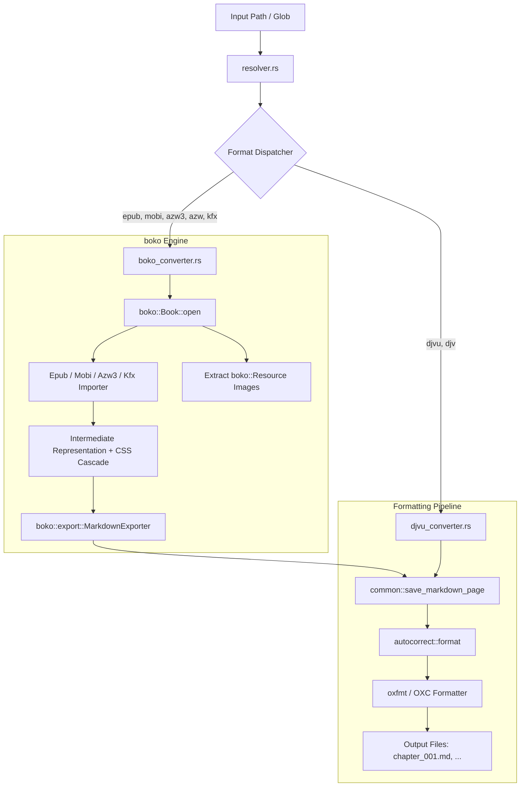

# tawata (多和田)

> Convert epub, mobi, azw3, kfx, and djvu files to markdown files

[](https://circleci.com/gh/paazmaya/tawata)
[](https://codecov.io/gh/paazmaya/tawata)



## Usage

```sh
tawata [OPTIONS] <INPUT>
```

`<INPUT>` is a file, a glob pattern (quote it) or a directory. Supported formats: `epub`, `mobi`, `azw3`, `azw`, `kfx` (via `boko`) and `djvu`, `djv`.

| Option              | Description                                                         |
| :------------------ | :------------------------------------------------------------------ |
| `-r`, `--recursive` | Search directories recursively                                      |
| `-a`, `--autocorrect` | Apply CJK/Western spacing fixes and merge split words              |
| `--no-oxfmt`        | Skip formatting the output with the OXC markdown formatter (formatting is on by default) |
| `--single-file`     | Write one `book.md` instead of `chapter_NNN.md` files (not for DJVU) |

Output goes to a directory next to the input file, named after the file stem, with images in `images/`.

### Input safety

Input files are never modified. Each ebook is opened read-only, read fully into memory and closed before conversion starts, so nothing holds the original file open or memory-mapped while it is processed. All output is written to the separate output directory, and `tawata` refuses to use the input path itself as an output location. The trade-off is that the whole book is held in memory during conversion.

### Examples

Every combination of `--recursive`, `--autocorrect`, `--single-file` and `--no-oxfmt`
(single files for the non-recursive ones, a directory for the recursive ones):

```sh
# 1. Defaults
tawata book.epub

# 2. No oxfmt
tawata --no-oxfmt book.epub

# 3. Single file
tawata --single-file book.epub

# 4. Single file + no oxfmt
tawata --single-file --no-oxfmt book.epub

# 5. Autocorrect
tawata -a book.epub

# 6. Autocorrect + no oxfmt
tawata -a --no-oxfmt book.epub

# 7. Autocorrect + single file
tawata -a --single-file book.epub

# 8. Autocorrect + single file + no oxfmt
tawata -a --single-file --no-oxfmt book.epub

# 9. Recursive
tawata -r ./library

# 10. Recursive + no oxfmt
tawata -r --no-oxfmt ./library

# 11. Recursive + single file
tawata -r --single-file ./library

# 12. Recursive + single file + no oxfmt
tawata -r --single-file --no-oxfmt ./library

# 13. Recursive + autocorrect
tawata -r -a ./library

# 14. Recursive + autocorrect + no oxfmt
tawata -r -a --no-oxfmt ./library

# 15. Recursive + autocorrect + single file
tawata -r -a --single-file ./library

# 16. Recursive + autocorrect + single file + no oxfmt
tawata -r -a --single-file --no-oxfmt ./library
```

Other input styles:

```sh
# Glob pattern (quoted so the tool expands it)
tawata "books/*.kfx"

# Non-recursive directory scan (top level only)
tawata ./library

# DJVU (always one file per page; --single-file is ignored)
tawata -a scan.djvu

# Debug logging
RUST_LOG=debug tawata book.epub
```

## The "Autocorrect" Feature Explained

It is designed to fix spacing and punctuation between CJK (Chinese/Japanese/Korean) characters and English words.

However, EPUBs have a second, more annoying whitespace issue: Split Words.
Often, publishers use individual <span> tags for every letter to apply specific kerning or CSS effects. This results in extracted text like H e l l o w o r l d.
I added a Regex pass (\b\w(?: \w)+\b) to detect sequences of single letters separated by spaces and merge them back into single words. Note: This occasionally merges very short valid phrases (like "I am" -> "Iam"), but for EPUB extraction, it fixes far more than it breaks.

## Background for the project name

The name of the project is for honouring the legacy of a late master, Mr Tawata from the Ryukyu archipelago, who contributed to the martial arts that we today know as **karate** and **ryukyu kobujutsu**.

There are forms carrying his name, such as "Tawata no Passai" and ["Tawata no Sai"](https://www.youtube.com/watch?v=YAQlFJIj32E), which both have distinctive use of a stance called "nekoashidachi" and sweeping motion related to the given stance.

[Read more about why these martial arts are important for me at `karatejukka.fi`.](https://karatejukka.fi)

## Version history

[Changes happening across different versions and upcoming changes are tracked in the `CHANGELOG.md` file.](CHANGELOG.md)

## License

Copyright (c) [Juga Paazmaya](https://paazmaya.fi) <paazmaya@yahoo.com>

Licensed under the [MIT license](LICENSE).
